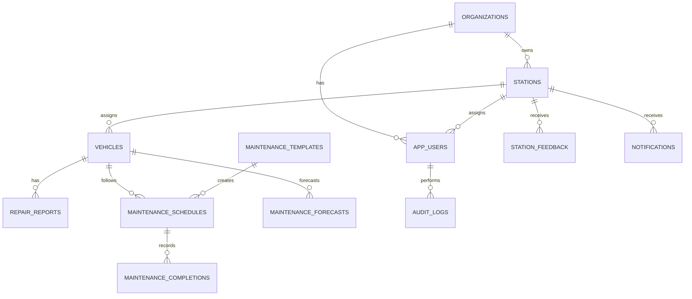

# Fleetwise backend and database design

This folder contains the first backend starter for Fleetwise plus the proposed shared backend design. The Express server has a basic health route and a PostgreSQL connection check. It does not yet provide fleet API endpoints, secure sign-in, or a connection from the existing front end. The current app still uses demo login and browser storage.

## The easy version

Imagine every station keeps its records in its own labeled folder inside one locked filing cabinet. The database is the cabinet. The backend is the trusted librarian: it checks who you are, opens only the folders you are allowed to see, and writes down changes. The web page is the screen people use to ask the librarian for help.

The server and database connection are the first pieces of that cabinet and librarian. Right now, the prototype still saves fleet information in the browser on one device.

## Proposed stack

- **Web API:** Node.js with Express, using the same JavaScript ecosystem as the current front end.
- **Database:** PostgreSQL for shared, relational fleet records and transactions.
- **Authentication:** server-side sessions with random, opaque tokens in `HttpOnly`, `Secure`, `SameSite` cookies. Store only a hash of each token. Store password hashes, never plaintext passwords.
- **Receipt photos:** private object storage; keep only the object key and metadata in PostgreSQL.
- **Live notifications:** start with short polling or Server-Sent Events; both use the authenticated API and station permissions.

## Files

- [`server.js`](server.js) starts the Express server and exposes server and database health checks.
- [`db.js`](db.js) loads local database settings and manages PostgreSQL connections.
- [`.env.example`](.env.example) is a safe sample of the settings needed for a local PostgreSQL connection. Copy it to `.env` and put your own database password there; never share `.env`.
- [`schema.sql`](schema.sql) is the initial PostgreSQL schema for multiple client organizations, stations, users, assets, repairs, service templates, recurring schedules, completion reports, feedback, forecasts, notifications, and audit history.
- [`API_DESIGN.md`](API_DESIGN.md) describes the REST API, role rules, and schedule generation flow.

## Connect to a local development database

1. In pgAdmin, create a database named `fleetwise` with the `postgres` user as its owner.
2. In PowerShell at the project root, run `Copy-Item backend/.env.example backend/.env`.
3. Open `backend/.env` and replace the example `DB_PASSWORD` with the password chosen when PostgreSQL was installed. Keep this file private; the root `.gitignore` excludes it.
4. Start the server from the project root with `npm.cmd run start:backend`.
5. Open `http://localhost:3000/api/health/database`. A successful connection returns `database: "connected"`.

The database health check uses PostgreSQL's `SELECT NOW()` command. It only proves the connection works; it does not create the Fleetwise tables. Apply `schema.sql` to a new development database in a later step.

## Data ownership and access

Every client has an `organizations` row. Every operational row has an `organization_id`, so one client cannot see another client's fleet. A station user is assigned to one `station_id`; the server takes that station from the authenticated session and ignores attempts to choose a different station in the request body. Admin users can access their organization's stations and fleet.

Authorization must be enforced by the API on every request. Do not put PostgreSQL credentials in `index.html` or browser JavaScript. PostgreSQL Row-Level Security can be added as defense in depth after the API's tenant context is established; the API must not rely on client-side role checks.

In simple words: a station must not be able to peek into another station's folder by changing a URL or button. The server checks the signed-in person's role and station every time. Hiding a button is not a lock; the server is the lock.

## Main database relationships

The picture below is a family tree: it shows which records belong to or point to other records. For example, one station can have many vehicles, and each vehicle can have many repair reports.

## Service schedule generation

This is the safe recipe for making schedules. First check what would be created, then ask an authorized admin to approve it, and only then save it.

1. An admin creates a service template and records the manufacturer/manual source.
2. A second admin action approves the template.
3. The admin chooses one station or all stations and requests a preview.
4. The backend matches the template to active vehicles and uses the latest valid service date or odometer to calculate the next due point. Vehicles without enough history appear as exceptions for manual review.
5. The admin confirms. The backend creates all schedules in a transaction and prevents duplicate template assignments.
6. Stations see schedules for their assigned vehicles and submit completion reports. The backend saves the report and advances the due point in one transaction.

Use the manufacturer schedule or an approved organization template for actual intervals. Machine learning can prioritize vehicles for earlier inspection, but should not invent safety-critical service intervals.

## Setup sequence for a real deployment

These are the build steps in order. Think of them like setting up the filing cabinet, checking it works with pretend records, and only then moving real records into it.

1. Provision PostgreSQL and a private file store; create separate development and production credentials.
2. Apply `schema.sql` to an empty development database, then convert it into versioned migrations before making schema changes.
3. Build the API endpoints in `API_DESIGN.md`; seed one organization, an admin, and stations through a protected setup process.
4. Add automated database backups, TLS, session expiration, login throttling, input validation, audit logging, and restore procedures.
5. Update `auth.js` and `app.js` to use the API instead of demo credentials and `localStorage`.
6. Import and verify existing fleet data before switching users. Keep the browser prototype export as a source only; do not automatically trust or import its demo records.

## Important rollout note

The schema is a design baseline, not a migration applied to a live database. Test it in a development database, review access rules, and create a backup before any production migration. Forecasting and generated summaries should remain reviewable by staff; every model forecast should retain its input snapshot, outcome, and model version.

### Small word guide

- **Backend:** the part behind the web page that checks users and handles shared records.
- **Database:** an organized place on a server where records stay saved for all stations.
- **PostgreSQL:** the database program this design uses.
- **API:** the set of doors the web page uses to ask the backend for information or changes.
- **Session:** a temporary sign-in pass that expires or can be cancelled when the user signs out.
- **Hash:** a scrambled proof used to check a password or session without saving the original secret.
- **Migration:** a numbered change to the database's structure, like adding a new labeled drawer safely.
- **Audit history:** a diary showing who changed important records and when.
- **Forecast:** a warning that asks a person to review a vehicle; it is not a guaranteed prediction of failure.
